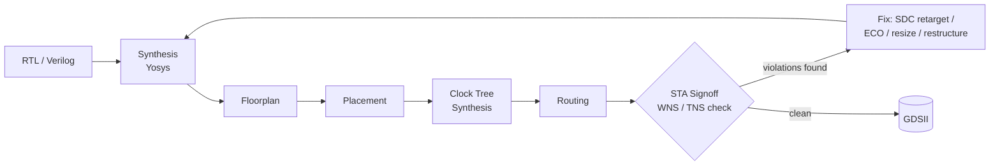
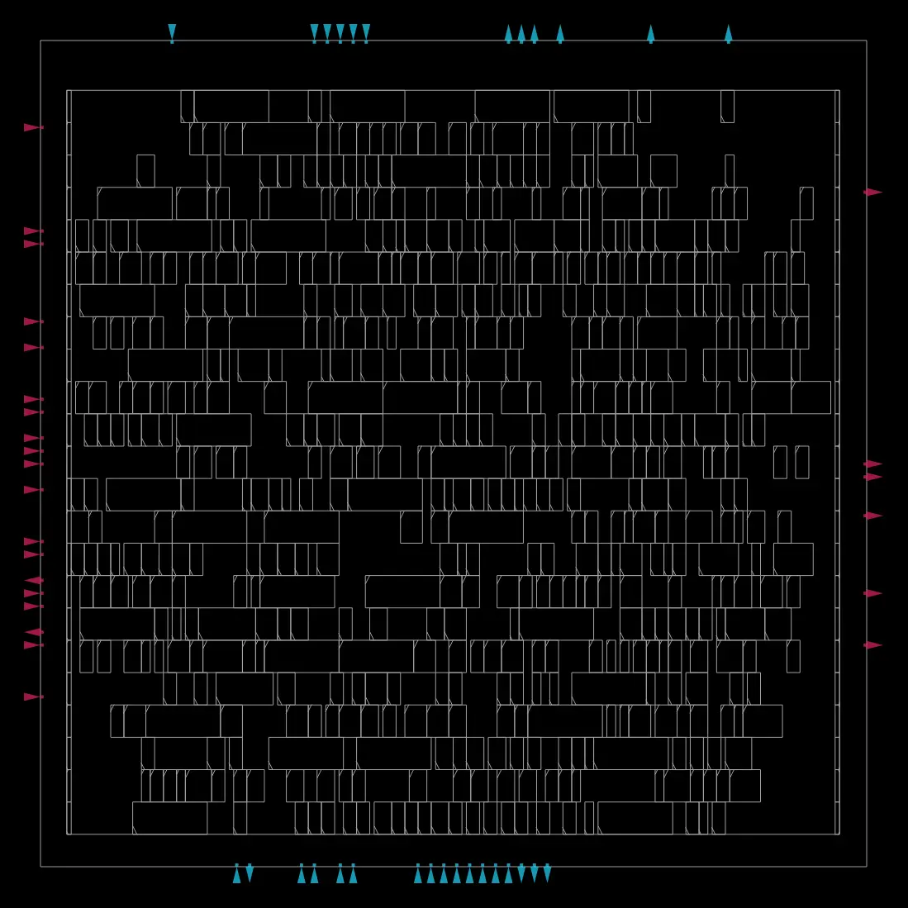
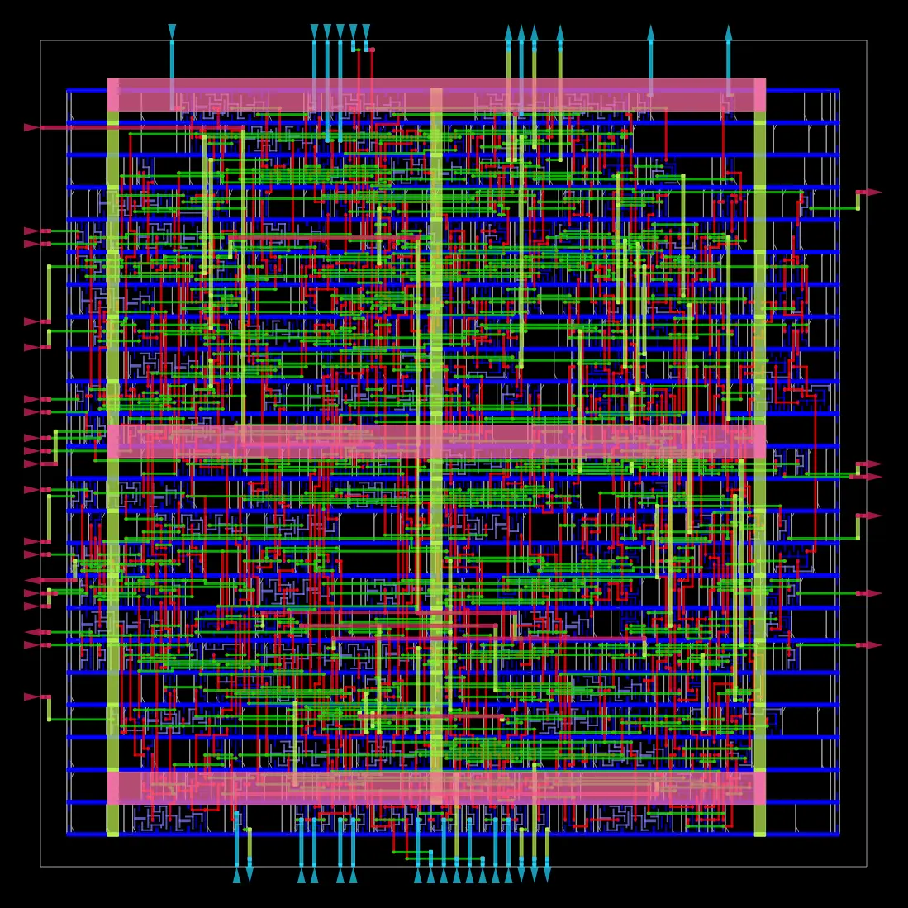
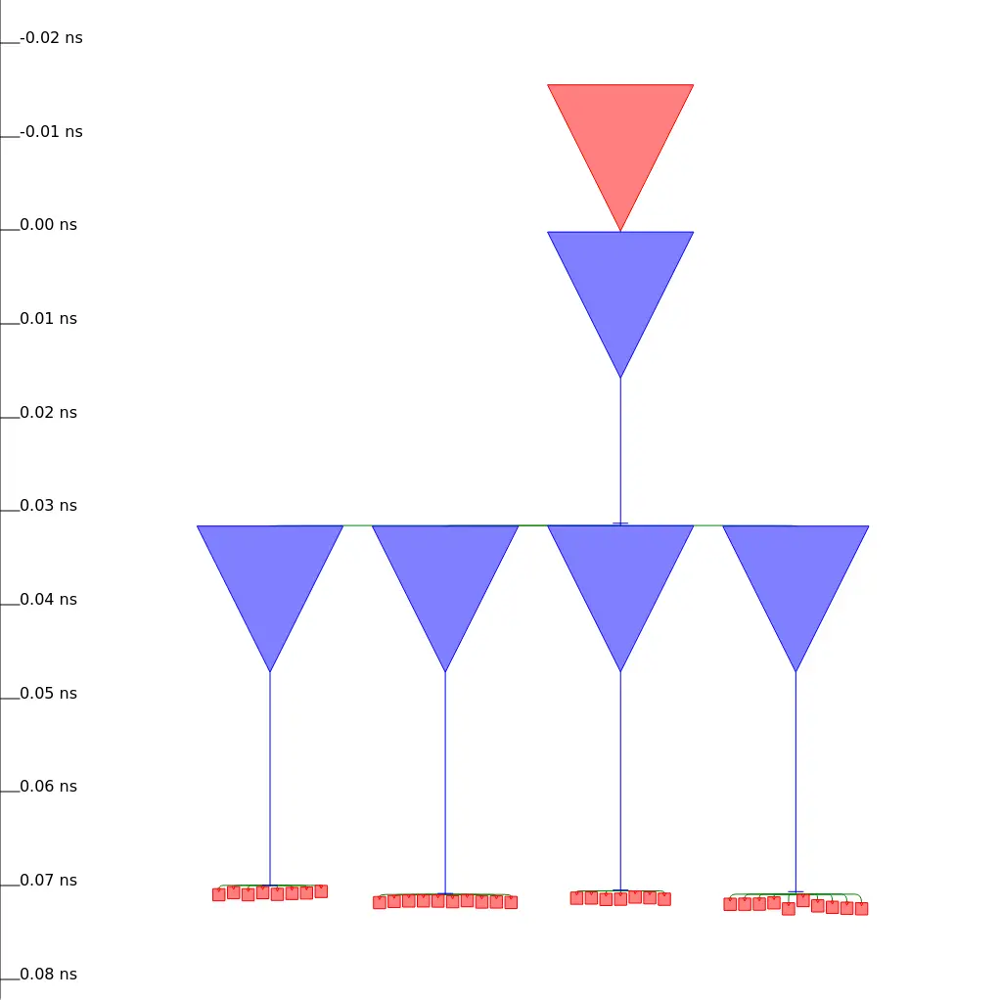
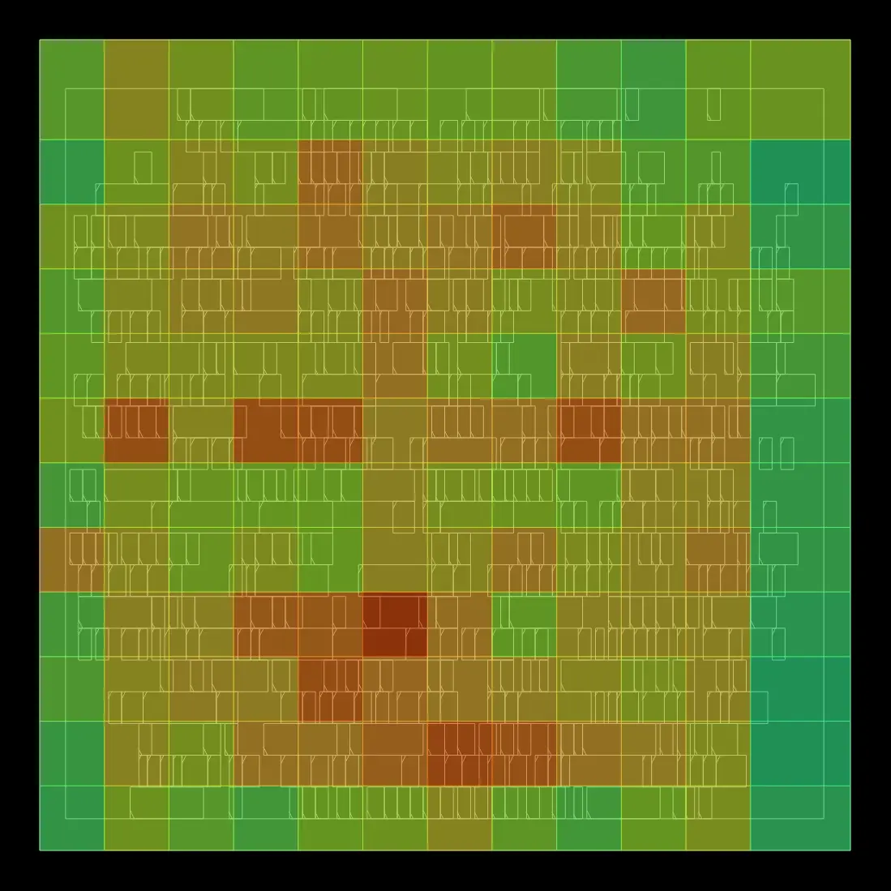

# GCD — RTL-to-GDSII Physical Design


-lightgrey)

A small RTL design (Greatest Common Divisor unit) taken end-to-end through the full digital physical design flow — synthesis, floorplanning, placement, clock tree synthesis, routing, and static timing analysis (STA) signoff — using the open-source [OpenROAD-flow-scripts](https://github.com/The-OpenROAD-Project/OpenROAD-flow-scripts) (ORFS) toolchain. Includes a real diagnosed-and-fixed timing violation, a five-point power/performance/area (PPA) sweep, and cross-checks against a real fabricatable PDK (SkyWater sky130) and a much larger real RISC-V core (ibex).

> **Companion project:** [`ibex-core-timing-eco`](https://github.com/Rennaafi/ibex-core-timing-eco) takes the ibex_core cross-check below further — root-causing its 240 setup violations to an undersized cell and closing them via manual + automated ECO (WNS -15.5 ps → +5 ps).

**Read the extended write-up:** [`docs/RTL-to-GDSII-GCD-Review.html`](docs/RTL-to-GDSII-GCD-Review.html) (open locally in any browser — self-contained, no build step)

---

## TL;DR

| | |
|---|---|
| **Design** | `gcd` — subtraction-based Euclidean GCD unit (FSM + datapath) |
| **Primary PDK** | Nangate45 (open, synthetic 45nm-class library) |
| **Cross-checked against** | SkyWater `sky130hd` (real 130nm PDK), `ibex_core` (real RISC-V CPU, same PDK) |
| **Toolchain** | Yosys (synthesis) → OpenROAD (floorplan/place/CTS/route/STA) → KLayout (GDSII viewer) |
| **Key result** | Diagnosed a real setup-timing violation (`WNS -0.16 ns`), root-caused it to an unrealistic clock target, retargeted to 2 GHz and reached clean post-route STA (`TNS 0.00 ns`, worst slack +0.04 ns, 0 setup/hold violations) with **65% lower power** |

---

## Skills Demonstrated

- **Full RTL-to-GDSII implementation** with an open-source flow: synthesis, floorplan, placement, CTS, routing, post-route STA
- **Timing debug from first principles** — reading OpenSTA path reports, identifying the critical path, separating a constraint problem from a design problem
- **PPA trade-off analysis** — a controlled clock-period sweep to locate the area/power "knee" of the design
- **Cross-process and cross-scale comparison** — same RTL on a real 130nm PDK (sky130hd); same flow on a 30x larger RISC-V core

---

## Flow Overview



Physical design is not a straight line — it's this loop. A flow can finish and produce a `.gds` file while still being functionally broken at speed; **STA signoff, not "the flow ran," is what determines whether a chip actually works.**

| Stage | Tool | What it does | Why |
|---|---|---|---|
| Synthesis | Yosys | RTL → gate-level netlist of real standard cells | Behavior → real, characterized components |
| Floorplan | OpenROAD | Die size, I/O placement, power straps | Defines the chip's footprint before anything is placed |
| Placement | OpenROAD | Assigns every gate an (x,y) position | Turns netlist into real geometry; drives area/timing |
| CTS | OpenROAD | Balanced clock buffer tree to every flip-flop | Prevents clock skew from breaking the design |
| Routing | OpenROAD | Draws real copper wires on real metal layers | Turns logical connectivity into manufacturable geometry |
| STA Signoff | OpenSTA (in OpenROAD) | Checks every path meets setup/hold timing | Confirms the chip works, not just that it's complete |

---

## The Design

`gcd` computes GCD via the classic subtraction-based Euclidean algorithm:

```
while b != 0:
    if a < b: swap(a, b)
    else:     a = a - b
return a
```

Structured as the standard **FSM + datapath** split:
- **`ctrl`** — 3-state FSM (`IDLE` → `CALC` → `DONE`) deciding what the datapath does each cycle
- **`dpath`** — `a_reg`/`b_reg`, a `<` comparator, a `==0` comparator, a subtractor, and muxes feeding the registers

RTL source: [`rtl/gcd.v`](rtl/gcd.v)

---

## Results: Diagnosing and Fixing a Real Timing Violation

### Attempt 1 — an unrealistic clock target (`0.25 ns` = 4 GHz)

| Metric | Value |
|---|---|
| WNS | **-0.16 ns** |
| TNS | **-7.18 ns** |
| Setup violations | 51 |
| Hold violations | 0 |
| Real achievable period | 0.41 ns → fmax ≈ 2.44 GHz |
| Total power | 6.38 mW |

Worst path, read directly from OpenSTA (`report_checks -path_delay max`) — not guessed:

```
Startpoint: dpath.a_reg.out[12]   (register)
  → NAND2 → INV → NOR2 → NAND2 → NOR2 → AND2 → NAND2
  → NAND3 → NAND2 → BUF_X8 → INV_X8 → NAND2 → NAND3
Endpoint:   dpath.b_reg.out[6]/D  (register)

14 logic gates deep · arrival 0.45 ns · required 0.29 ns
slack = -0.16 ns  (VIOLATED)
```

Full report: [`reports/nangate45_0.25ns_violating_6_finish.rpt`](reports/nangate45_0.25ns_violating_6_finish.rpt) · SDC: [`constraints/constraint_0.25ns_violating.sdc`](constraints/constraint_0.25ns_violating.sdc)

**Root cause:** not a bug — an unrealistic constraint. `report_clock_min_period` reported the real ceiling directly: 0.41 ns. The path itself is the `a<b` comparator result rippling through the FSM's control logic and back through a mux into `b_reg`.

### The fix — retarget to a real clock (`0.50 ns` = 2 GHz)

| Metric | Before (0.25 ns) | After (0.50 ns) |
|---|---|---|
| WNS | -0.16 ns | **+0.04 ns** |
| TNS | -7.18 ns | **0.00 ns** |
| Setup violations | 51 | **0** |
| Total power | 6.38 mW | **2.22 mW (-65%)** |

Full report: [`reports/nangate45_0.50ns_signoff_clean_6_finish.rpt`](reports/nangate45_0.50ns_signoff_clean_6_finish.rpt) · metrics: [`reports/nangate45_0.50ns_signoff_clean_metrics.json`](reports/nangate45_0.50ns_signoff_clean_metrics.json) · SDC: [`constraints/constraint_0.50ns_signoff.sdc`](constraints/constraint_0.50ns_signoff.sdc)

**Why power dropped too:** dynamic power scales with clock frequency, *and* the optimizer stopped fighting an impossible target (no more excess buffer insertion / cell up-sizing trying to chase 4 GHz). An unrealistic constraint doesn't just fail timing — it makes the chip bigger and hungrier for no real gain.

---

## PPA Sweep

Same design, same PDK, sweeping only the clock period target ([full data](reports/ppa_sweep_metrics.json)):

| Clock period | Target freq | WNS | TNS | Setup viol. | Achieved fmax | Stdcell area | Total power |
|---|---|---|---|---|---|---|---|
| 0.25 ns | 4.00 GHz | -0.16 | -7.18 | 51 | ~2.44 GHz | – | 6.38 mW |
| 0.30 ns | 3.33 GHz | -0.11 | -4.77 | 49 | 2.42 GHz | 894.0 µm² | 4.98 mW |
| 0.40 ns | 2.50 GHz | -0.02 | -0.80 | 45 | 2.36 GHz | 855.7 µm² | 3.61 mW |
| **0.50 ns** | 2.00 GHz | **+0.04** | **0.00** | **0** | 2.22 GHz | 674.6 µm² | 2.22 mW |
| 0.60 ns | 1.67 GHz | +0.12 | 0.00 | 0 | 2.18 GHz | 674.8 µm² | 1.86 mW |

**Takeaway:** achieved fmax barely moves (2.44 → 2.18 GHz) across the whole sweep even though the target swung from 4 GHz to 1.67 GHz — this logic, in this library, genuinely tops out around ~2.2–2.4 GHz. Past that, harder targets just burn area/power fighting a losing battle. `0.50 ns` is the real knee of the curve: first fully clean point, with 0.60 ns buying little extra for a real frequency sacrifice.

---

## Visual Outputs

All images below are real OpenROAD renders from this project's `gcd` run (saved automatically since ORFS runs OpenROAD headless), not illustrations.

| Placement only | Fully routed |
|---|---|
|  |  |
| Standard cells snapped into rows, before any wire is drawn. | Every net wired; each color is a different metal layer. |

| Clock tree (CTS) | Routing congestion |
|---|---|
|  |  |
| Balanced buffer tree — all leaves land ~0.07 ns deep, matching the 0.00 ns setup skew STA reported. | Green = free routing tracks, red = crowded. The hotspot lines up with the comparator/control critical-path region. |

---

## Timing Closure Techniques — Beyond Relaxing the Clock

Loosening the SDC (what we did above) is the easiest lever, but it's *global* — it slows the whole chip to save one bad path. Real PPA engineering reaches for more surgical tools first. Catalogued here against our actual violated path (`a_reg → comparator/control logic → b_mux → b_reg`), ordered least → most invasive:

| # | Technique | Invasiveness | Idea | Status in this project |
|---|---|---|---|---|
| 1 | **Cell sizing / ECO** | Least — tool-driven, sometimes needs a manual push | Swap slow cells on the critical path for faster same-function variants (e.g. `NAND2_X1`→`NAND2_X4`); no RTL/netlist change | Automatic here (ORFS's optimizer inserted 58–166 `timing_repair_buffer` cells depending on target). **Executed manually at CPU scale** in [`ibex-core-timing-eco`](https://github.com/Rennaafi/ibex-core-timing-eco) (`replace_cell` + `repair_timing`, 240 violations closed) |
| 2 | **Logic restructuring** | Same behavior, different gate shape | Re-implement the same Boolean function with a shallower/different topology (e.g. carry-lookahead vs. ripple comparator) | Documented for future iteration — controlled by synthesis mapping knobs like `ADDER_MAP_FILE` / `SWAP_ARITH_OPERATORS` seen in other ORFS design configs |
| 3 | **Pipelining** | Most invasive — changes microarchitecture/latency | Register the comparator result on its own cycle instead of consuming it combinationally | Documented for future iteration — requires RTL/FSM redesign + re-verification |
| 4 | **Floorplan / placement tweaks** | Attacks wire delay specifically | Constrain `a_reg`/`b_reg`/comparator placement to shorten the wires between them | Documented for future iteration — congestion heatmap above shows exactly where this would target |
| 5 | **Buffering / multi-Vt swaps** | Targeted physical technique | Insert buffers for slew, or swap critical-path cells to low-Vt (faster, leakier) variants | Documented for future iteration — `nangate45` is single-Vt (illustrative only); `sky130hd`'s hd/hs/ls Vt families are the natural place to actually try this |

> **Note on scope:** in this repo, only the SDC retarget and the PPA sweep were executed. Technique 1 (cell sizing / ECO) was carried out on ibex_core in the [companion repo](https://github.com/Rennaafi/ibex-core-timing-eco). Techniques 2–5 are a roadmap for future iterations and are not claimed as completed work.

---

## Cross-Platform Validation

### Real PDK: SkyWater `sky130hd` (130nm, real fabricatable process)

| Metric | nangate45 @0.25ns | sky130hd @1.10ns |
|---|---|---|
| WNS | -0.16 ns | -1.46 ns |
| TNS | -7.18 ns | -65.09 ns |
| Setup violations | 51 | 63 |
| Critical path | 14 gates, 0.45 ns | 15 gates, 2.63 ns |
| Real fmax ceiling | ~2.44 GHz | ~390 MHz |

Same algorithm, similar gate count — but **~6x slower per path** on real 130nm silicon vs. the synthetic 45nm teaching library. Left intentionally un-tuned as a reference point (see [`reports/sky130hd_1.10ns_reference_6_finish.rpt`](reports/sky130hd_1.10ns_reference_6_finish.rpt)) rather than "fixed," to keep the process-node comparison honest.

### Scale-up: `ibex_core` (real RISC-V CPU, same nangate45 PDK)

| Metric | gcd | ibex_core |
|---|---|---|
| Instances | 1,073 | 31,761 |
| Die area | 1,278 µm² | 57,255 µm² (~45x) |
| Full flow runtime | ~90 s | ~873 s (~14.5 min) |
| WNS (shipped constraint) | -0.16 ns @0.25ns | **-0.0155 ns** @2.2ns |
| Setup violations | 51 | 240 (tiny individual slacks) |

See [`reports/ibex_2.20ns_metrics.json`](reports/ibex_2.20ns_metrics.json). At CPU scale, a well-chosen constraint can miss by *picoseconds* across hundreds of paths — a different flavor of "almost closed" than the first gcd attempt.

**Follow-up:** these 240 violations were subsequently diagnosed and closed via ECO (WNS -15.5 ps → +5 ps, STA-verified) — full write-up in [`ibex-core-timing-eco`](https://github.com/Rennaafi/ibex-core-timing-eco).

---

## Repository Structure

```
.
├── README.md
├── LICENSE
├── NOTICE.md
├── rtl/
│   └── gcd.v                                  # original RTL (PyMTL-generated example)
├── config/
│   └── config.mk                              # ORFS design config (nangate45/gcd)
├── constraints/
│   ├── constraint_0.25ns_violating.sdc        # the unrealistic first attempt
│   └── constraint_0.50ns_signoff.sdc          # the fixed, signoff-clean version
├── reports/
│   ├── nangate45_0.25ns_violating_6_finish.rpt
│   ├── nangate45_0.50ns_signoff_clean_6_finish.rpt
│   ├── nangate45_0.50ns_signoff_clean_metrics.json
│   ├── ppa_sweep_metrics.json                 # 5-point clock sweep, machine-readable
│   ├── sky130hd_1.10ns_reference_6_finish.rpt
│   └── ibex_2.20ns_metrics.json
├── images/                                    # real OpenROAD layout renders
└── docs/
    └── RTL-to-GDSII-GCD-Review.html           # extended, illustrated write-up
```

---

## Reproducing This Work

Requires [OpenROAD-flow-scripts](https://github.com/The-OpenROAD-Project/OpenROAD-flow-scripts) built locally (tested on WSL2/Ubuntu 22.04).

```bash
cd OpenROAD-flow-scripts
source env.sh
cd flow

# Copy this repo's RTL/config into flow/designs/nangate45/gcd/ and use
# constraints/constraint_0.50ns_signoff.sdc as constraint.sdc, then:
make DESIGN_CONFIG=./designs/nangate45/gcd/config.mk

# Read the signoff report:
grep -A2 "report_wns\|report_tns\|period_min" reports/nangate45/gcd/base/6_finish.rpt

# View the routed layout:
klayout results/nangate45/gcd/base/6_final.gds

# Explore live timing interactively:
make DESIGN_CONFIG=./designs/nangate45/gcd/config.mk gui_final
```

---

## Acknowledgments & License

- **Toolchain:** [OpenROAD](https://github.com/The-OpenROAD-Project/OpenROAD) / [OpenROAD-flow-scripts](https://github.com/The-OpenROAD-Project/OpenROAD-flow-scripts) (BSD 3-Clause, © The Regents of the University of California), [Yosys](https://github.com/YosysHQ/yosys), [KLayout](https://www.klayout.de/).
- **RTL example:** `gcd.v` originates from the ORFS example designs (originally generated via [PyMTL](https://github.com/pymtl)); see [`NOTICE.md`](NOTICE.md) for full attribution.
- **PDKs:** Nangate45 / FreePDK45 (NCSU, open academic cell library); [SkyWater SKY130](https://github.com/google/skywater-pdk) (Apache License 2.0).
- This repository's original contributions — analysis, documentation, sweep results, and the extended write-up — are shared under the [MIT License](LICENSE). Upstream tool/RTL/PDK components retain their own licenses (see `NOTICE.md`).
